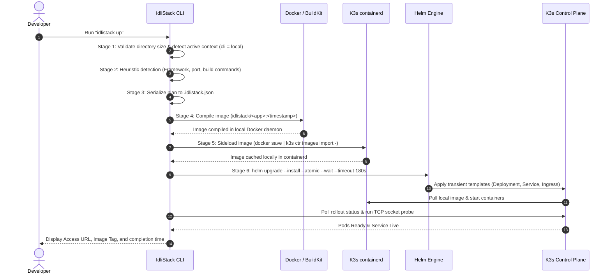

# Kubernetes, Helm & IdliStack Cluster Operations Guide

A unified reference covering the operational commands, future cloud cluster setup, and the end-to-end deployment lifecycle explaining which component performs each task.

---

## 1. System Architecture & Actor Responsibilities (TL;DR Flow)

### The Primary Actors

| Actor | Role & Core Responsibility |
| :--- | :--- |
| **Developer** | Invokes CLI commands (`idlistack up`, `kubectl`, `helm`) and switches context. |
| **IdliStack CLI** | Orchestrates detection, size verification, builds, Helm templating, and health probes. |
| **Docker / BuildKit** | Compiles project files into an OCI image tag using caching mounts or Railpack. |
| **K3s containerd** | Local runtime receiving sideloaded container images directly, bypassing external registries. |
| **Helm Client** | Executes atomic release upgrades, tracks revisions, and triggers rollbacks on failure. |
| **K3s Control Plane** | Schedules pods, allocates persistent storage, creates services, and manages Traefik Ingress. |
| **Teleport / Frappe** *(Cloud only)* | Mints short-lived scoped kubeconfigs (bypassed when deploying to local `cli` context). |

---

### Step-by-Step Flow: Who Does What?



---

## 2. Context & Cluster Management Commands

Commands for switching between local development clusters and cloud environments.

### `kubectl config get-contexts`
* **Purpose:** Lists all configured Kubernetes contexts, the target cluster, authorized user, and active namespace.
* **Explanation:** An asterisk (`*`) indicates your currently active context.
```bash
kubectl config get-contexts
```

### `kubectl config use-context cli`
* **Purpose:** Switches active target to the local K3s cluster.
* **Explanation:** All subsequent `kubectl`, `helm`, and `idlistack` commands interact with the local machine (`https://127.0.0.1:6443`).
```bash
kubectl config use-context cli
```

### `kubectl config use-context whatomate-vendor-context`
* **Purpose:** Switches active target to the cloud vendor context.
* **Explanation:** Used when targeting the remote cloud cluster.
```bash
kubectl config use-context whatomate-vendor-context
```

### `kubectl config current-context`
* **Purpose:** Displays the name of the currently active context.
* **Explanation:** Quick sanity check before running destructive or deployment commands.
```bash
kubectl config current-context
```

### `kubectl cluster-info`
* **Purpose:** Displays control plane endpoint and core cluster service status.
* **Explanation:** Confirms that the API server is reachable and responsive.
```bash
kubectl cluster-info
```

### `kubectl get nodes -o wide`
* **Purpose:** Shows all worker and control-plane nodes with status, roles, IP addresses, OS, and kernel versions.
* **Explanation:** Verifies cluster health and capacity.
```bash
kubectl get nodes -o wide
```

---

## 3. Adding a New Cloud Kubeconfig (Future Setup)

When your new cloud server is provisioned, use one of the two methods below to register it without breaking the local `cli` context.

### Method A: Merge a New Cloud Kubeconfig File
If you receive a complete `.yaml` file (`new-cloud.yaml`) from the cloud provider:
```bash
# 1. Merge the new config with your existing active file
KUBECONFIG=~/.kube/whatomate-vendor-kubeconfig.yaml:/path/to/new-cloud.yaml \
  kubectl config view --flatten > ~/.kube/whatomate-vendor-kubeconfig.yaml.tmp

# 2. Overwrite the active file with the merged configuration
mv ~/.kube/whatomate-vendor-kubeconfig.yaml.tmp ~/.kube/whatomate-vendor-kubeconfig.yaml

# 3. Verify the new context appears in the list
kubectl config get-contexts
```

### Method B: Update `whatomate-vendor-context` In-Place
If you keep the same context name and receive a new server IP and ServiceAccount token:
```bash
# 1. Update the API server endpoint IP
kubectl config set-cluster k3s-server --server=https://<NEW_CLOUD_IP>:6443

# 2. Update the authentication bearer token
kubectl config set-credentials whatomate-vendor --token="<NEW_SERVICE_ACCOUNT_TOKEN>"

# 3. Test connectivity to the new cloud cluster
kubectl --context whatomate-vendor-context get nodes
```

---

## 4. Helm Deployment & Release Lifecycle Commands

Helm packages your application manifests (Deployments, Services, ConfigMaps, Ingress) into versioned releases.

### `helm list -A`
* **Purpose:** Lists deployed Helm releases across all namespaces.
* **Explanation:** Shows release names, revisions, update timestamps, and chart versions.
```bash
helm list -A
```

### `helm list -n <namespace>`
* **Purpose:** Lists releases scoped strictly to a specific project namespace.
* **Explanation:** Limits clutter when searching for an isolated application release.
```bash
helm list -n idlistack-<app>
```

### `helm status <release-name> -n <namespace>`
* **Purpose:** Displays current release status, last deploy time, and deployed Kubernetes resources.
* **Explanation:** Essential for inspecting newly applied services and pods.
```bash
helm status <release-name> -n <namespace>
```

### `helm history <release-name> -n <namespace>`
* **Purpose:** Displays the full revision history of an application release.
* **Explanation:** Allows you to identify which revision was successful or failed.
```bash
helm history <release-name> -n <namespace>
```

### `helm rollback <release-name> <revision> -n <namespace>`
* **Purpose:** Reverts the release to a specific previous revision number.
* **Explanation:** Instantly redeploys the manifests and images from that prior working revision.
```bash
helm rollback <release-name> 1 -n <namespace>
```

### `helm uninstall <release-name> -n <namespace>`
* **Purpose:** Teardown a release and delete its associated Kubernetes objects.
* **Explanation:** Removes the deployment, pods, and services created by Helm while preserving persistent volume claims.
```bash
helm uninstall <release-name> -n <namespace>
```

---

## 5. Kubernetes Inspection & Troubleshooting Commands

Commands to inspect live pods, examine logs, and diagnose failures.

### `kubectl get pods -A`
* **Purpose:** Lists every pod running across the entire cluster.
* **Explanation:** Use to verify system components (`coredns`, `traefik`) and user applications.
```bash
kubectl get pods -A
```

### `kubectl get pods -n <namespace> -o wide`
* **Purpose:** Lists pods in a target namespace with pod IP and host node information.
* **Explanation:** Shows restart counts and container readiness status.
```bash
kubectl get pods -n <namespace> -o wide
```

### `kubectl logs -f <pod-name> -n <namespace>`
* **Purpose:** Streams container logs in real time (follow mode).
* **Explanation:** Add `-c <container-name>` if the pod has multiple containers (e.g. sidecars).
```bash
kubectl logs -f <pod-name> -n <namespace>
```

### `kubectl get svc -A`
* **Purpose:** Lists all cluster services, their ClusterIPs, NodePorts, and external endpoints.
* **Explanation:** Shows which port forwards traffic to your running application containers.
```bash
kubectl get svc -A
```

### `kubectl get ingress -A`
* **Purpose:** Lists Ingress HTTP routing rules, hostnames, and paths managed by Traefik.
* **Explanation:** Displays public and local host routes configured for your deployments.
```bash
kubectl get ingress -A
```

### `kubectl describe pod <pod-name> -n <namespace>`
* **Purpose:** Detailed diagnostic view of a pod including environment variables, volumes, and lifecycle events.
* **Explanation:** Always check the **Events** section at the bottom to debug `CrashLoopBackOff`, `ImagePullBackOff`, or probe failures.
```bash
kubectl describe pod <pod-name> -n <namespace>
```

### `kubectl port-forward svc/<service-name> <local-port>:<svc-port> -n <namespace>`
* **Purpose:** Bridges a local machine port directly to a Kubernetes Service.
* **Explanation:** Allows testing internal services (e.g. databases, private APIs) without creating an Ingress rule.
```bash
kubectl port-forward svc/<service-name> 8080:80 -n <namespace>
```

### `kubectl exec -it <pod-name> -n <namespace> -- /bin/sh`
* **Purpose:** Opens an interactive shell session inside a running pod container.
* **Explanation:** Useful for inspecting configuration files, testing network connectivity, or running manual database migrations.
```bash
kubectl exec -it <pod-name> -n <namespace> -- /bin/sh
```

### `kubectl get events -n <namespace> --sort-by='.metadata.creationTimestamp'`
* **Purpose:** Streams recent chronological events in a namespace.
* **Explanation:** Helps pinpoint scheduling errors, node pressure, or container restarts.
```bash
kubectl get events -n <namespace> --sort-by='.metadata.creationTimestamp'
```

---

## 6. IdliStack Local Workflow Commands

The high-level CLI commands orchestrating local builds, container sideloading, and Helm deployments.

### `idlistack up`
* **Purpose:** Executes the complete 6-stage automated build, sideload, and rollout pipeline.
* **Explanation:** Runs source size validation, framework detection, OCI image build, direct K3s containerd import, and Helm atomic rollout.
```bash
idlistack up
```

### `idlistack up --inspect`
* **Purpose:** Dry-run inspection that analyzes the project and outputs the generated build plan JSON.
* **Explanation:** Previews detected framework, runtime versions, install/start commands, and target ports without building an image or deploying.
```bash
idlistack up --inspect
```

### `idlistack status`
* **Purpose:** Checks live status of the current project deployment and launches the local web dashboard.
* **Explanation:** Displays running pods, allocated memory/CPU, ingress endpoints, and provides a web UI link.
```bash
idlistack status
```

### `idlistack logs`
* **Purpose:** Streams aggregated logs across all pods associated with the current project.
* **Explanation:** Eliminates the need to find specific pod hashes with `kubectl`.
```bash
idlistack logs
```

### `idlistack down`
* **Purpose:** Tears down the project release and cleans up the associated Kubernetes namespace.
* **Explanation:** Uninstalls Helm manifests and purges ephemeral project artifacts.
```bash
idlistack down
```
