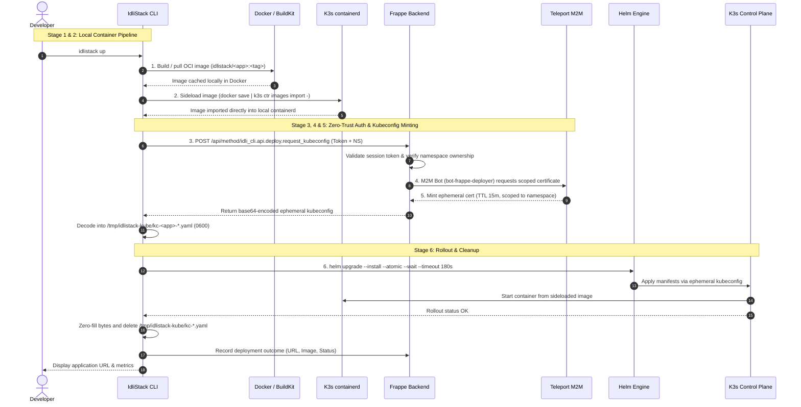

# Complete Sequential Deployment Flow (TL;DR)

A structured reference detailing how IdliStack coordinates container compilation, local sideloading, zero-trust Teleport authentication, and atomic Helm orchestration.

---

## 1. Visual Sequence Flow



---

## 2. Step-by-Step Breakdown

### Step 1: OCI Image Creation
* **What Happens:** The CLI inspects the project directory via Railpack or Dockerfile, then builds or pulls the image using Docker BuildKit caching mounts.
* **Component:** Docker Daemon / BuildKit (`ResolveRailpackBinary()`).
* **Artifact:** Deterministic tag generated as `idlistack/<project-name>:<unix-timestamp>`.
* **Path / Storage:** Cached in local Docker layer storage (`/var/lib/docker/overlay2/`).

---

### Step 2: Local Sideloading (Direct Containerd Injection)
* **What Happens:** Bypasses public Docker registries to eliminate upload latency and credential management. Streams the raw tarball directly from Docker into K3s containerd via standard UNIX pipes.
* **Command:**
  ```bash
  docker save <imageTag> | k3s ctr images import -
  ```
* **Fallback:** If pipe fails, writes temporary tarball to `/tmp/idlistack-<timestamp>.tar` and imports before auto-deleting.
* **Storage Location:** `/var/lib/rancher/k3s/agent/containerd/`.

---

### Step 3: User Authentication & Namespace Verification
* **What Happens:** The CLI reads the cached developer session from `~/.idlistack/credentials.json` and transmits it in the `X-CLI-Token` header.
* **Endpoint:** `POST http://localhost:8000/api/method/idli_cli.api.deploy.request_kubeconfig`
* **Checks Performed by Frappe:**
  1. Validates the 48-byte crypto session token against `CLI-User Session`.
  2. Ensures the session has not expired (30-day default).
  3. Verifies namespace ownership in `CLI-Namespace` (assigns default if first deployment).

---

### Step 4: Machine-to-Machine (M2M) Bot Intervention
* **What Happens:** Frappe acts as the trusted identity broker between the developer and Teleport. Rather than granting users direct cluster administration rights, Frappe assumes a dedicated service identity.
* **Identity Used:** `bot-frappe-deployer` with machine certificate `~/.idlistack/teleport-bot/identity`.
* **RBAC Constraints Requested:**
  - **Kubernetes Group:** `idlistack:developer`
  - **Kubernetes Namespace:** Strictly restricted to `idlistack-<app>` (cannot access `kube-system` or other tenants).

---

### Step 5: Secure Ephemeral Token Issuance
* **What Happens:** Teleport validates the bot's request, issues an X.509 client certificate restricted to the target namespace with a 15-minute TTL (900 seconds), and returns the kubeconfig to Frappe.
* **Handoff:** Frappe base64-encodes the kubeconfig and sends it back to the CLI.
* **Local File Creation:**
  - File path: `/tmp/idlistack-kube/kc-<app>-<randomSuffix>.yaml`
  - Permissions: `0600` (readable only by the current user).
  - Environment: CLI sets `KUBECONFIG=/tmp/idlistack-kube/kc-...yaml`.

---

### Step 6: Atomic Helm Deployment & Zero-Fill Teardown
* **What Happens:** Helm applies transient chart templates generated in `/tmp/idlistack-helm-<app>-*` using the ephemeral kubeconfig.
* **Command:**
  ```bash
  helm upgrade --install <app> <transientChartDir> \
    --namespace idlistack-<app> \
    --create-namespace \
    --wait \
    --timeout 180s \
    --atomic
  ```
* **Rollback Safeguard:** `--atomic` automatically rolls back to the prior revision if health checks or startup probes fail.
* **Zero-Fill Destruction:** An exit handler overwrites the temporary kubeconfig file with zero bytes (`0x00`) before unlinking it, ensuring no lingering credentials remain on disk.
* **Audit Logging:** Reports outcome and live access URL back to Frappe (`idli_cli.api.deploy.record_deployment`).

---

## 3. Summary of Roles & Boundaries

| Step | Actor | Primary Security / Performance Benefit |
| :---: | :--- | :--- |
| **1** | Docker / BuildKit | Fast incremental builds via cached layer mounts. |
| **2** | K3s containerd | Zero network latency; no external registry credentials needed. |
| **3** | Frappe Framework | Centralized tenant multi-tenancy & audit tracking. |
| **4** | Teleport M2M Bot | Developers never receive root / `cluster-admin` credentials. |
| **5** | Ephemeral Kubeconfig | Short-lived (15 min) certificates eliminate leaked credential risks. |
| **6** | Helm Engine | Guaranteed atomic rollouts with automatic zero-fill file shredding. |
